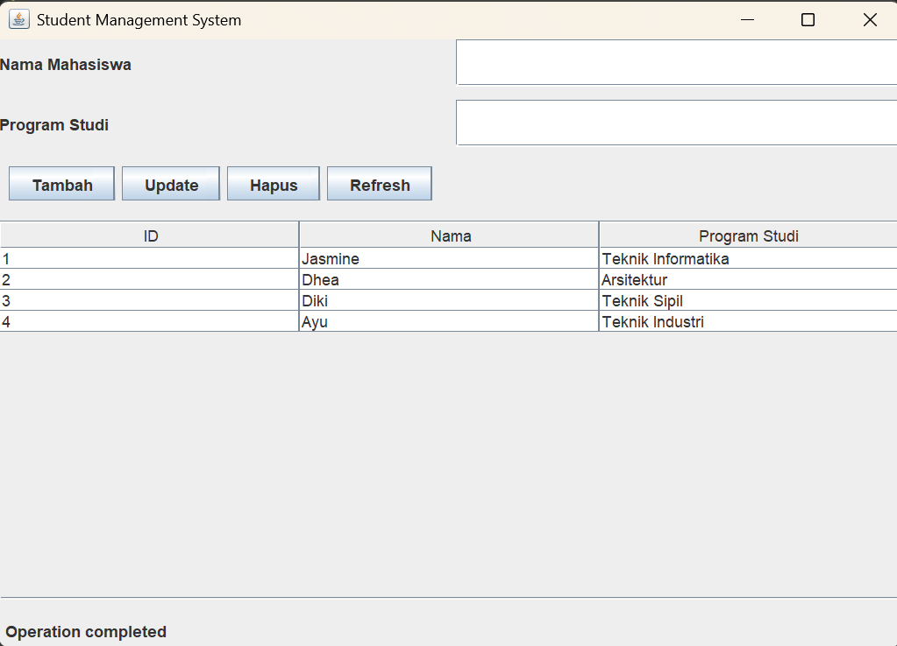

# Thread and Database in Java

A simple Java project that demonstrates how to connect a Java application to a MySQL database using JDBC and how to handle database operations with multithreading.

This project uses a Student Management System as a case study. Users can manage student records through a Java Swing interface while database operations run in the background.

## About the Project

The main purpose of this project is to explore the use of JDBC and multithreading in Java, especially when working with a graphical user interface.

Instead of executing database queries directly on the GUI thread, this application uses a separate thread to handle database operations. This helps keep the interface responsive while waiting for the database to finish processing.

## Features

- Display a list of students.
- Add new student records.
- Update existing student information.
- Delete student records.
- Connect to MySQL using JDBC.
- Execute SQL queries using PreparedStatement.
- Manage database transactions with commit and rollback.
- Run database operations in background threads.
- Update the GUI using SwingUtilities.invokeLater().
- Display operation status, such as Loading..., Saving..., Updating..., and Deleting....

## Technologies

| Technology | Usage |
|---|---|
| Java | Main programming language |
| Java Swing | Building the graphical interface |
| MySQL | Storing student records |
| JDBC | Connecting Java to MySQL |
| MySQL Connector/J | MySQL JDBC driver |
| Multithreading | Running database operations in the background |
| VS Code | Code editor |
| Laragon | Local MySQL environment |

## Project Structure

```text
Thread_and_Database/
│
├── .vscode/
│   └── settings.json
│
├── lib/
│   └── mysql-connector-j-26.10.0.jar
│
├── src/
│   ├── DBConnection.java
│   ├── Mahasiswa.java
│   ├── MahasiswaDAO.java
│   ├── MahasiswaFrame.java
│   └── Main.java
│
└── bin/
    └── Compiled Java Classes
```

### Class Description

| Class | Description |
|---|---|
| `DBConnection.java` | Handles the connection between Java and MySQL. |
| `Mahasiswa.java` | Represents student data. |
| `MahasiswaDAO.java` | Contains database operations and SQL queries. |
| `MahasiswaFrame.java` | Handles the application interface and user interactions. |
| `Main.java` | Starts the application. |

## Database Setup

Before running the application, create a MySQL database named `db_thread_java`.

### 1. Create the Database

```sql
CREATE DATABASE db_thread_java;

USE db_thread_java;
```

### 2. Create the Table

```sql
CREATE TABLE mahasiswa (
    id INT AUTO_INCREMENT PRIMARY KEY,
    nama VARCHAR(100) NOT NULL,
    prodi VARCHAR(100) NOT NULL
);
```

### 3. Insert Sample Data

```sql
INSERT INTO mahasiswa (nama, prodi)
VALUES
('Jasmine', 'Teknik Informatika'),
('Dhea', 'Arsitektur'),
('Diki', 'Teknik Sipil');
```

### 4. Configure the Database Connection

```java
private static final String URL =
        "jdbc:mysql://localhost:3306/db_thread_java";

private static final String USER = "root";
private static final String PASSWORD = "";
```

The default configuration above assumes that MySQL is running on port `3306` with the `root` user and no password.

## MySQL Connector/J

This project uses MySQL Connector/J to establish a connection between Java and MySQL.

To add the driver:

1. Download MySQL Connector/J from the [official MySQL website](https://dev.mysql.com/downloads/connector/j/).
2. Extract the downloaded ZIP file.
3. Copy the `.jar` file into the `lib` folder.
4. Make sure the library is included in the project's classpath.

The library is configured in `.vscode/settings.json`:

```json
{
    "java.project.sourcePaths": ["src"],
    "java.project.referencedLibraries": [
        "lib/**/*.jar"
    ],
    "java.project.outputPath": "bin"
}
```

## Implementation

### 1. CRUD Operations

The application supports four basic database operations:

| Operation | SQL Query | Description |
|---|---|---|
| Create | INSERT | Adds a new student to the database. |
| Read | SELECT | Retrieves student records. |
| Update | UPDATE | Changes existing student information. |
| Delete | DELETE | Removes a student record. |

All queries are handled in `MahasiswaDAO.java` using JDBC.

### 2. DAO Pattern

The project uses the Data Access Object (DAO) pattern to keep database operations separate from the GUI.

The `MahasiswaDAO` class handles SQL queries, database connections, and transaction management, while `MahasiswaFrame` focuses on displaying data and handling user actions.

### 3. Database Transactions

JDBC transaction management is used when inserting, updating, and deleting student records.

The application uses:

- `setAutoCommit(false)` to manage transactions manually.
- `commit()` to save changes when an operation succeeds.
- `rollback()` to cancel changes when an error occurs.

### 4. Multithreading

Database operations are executed in a separate thread so that the GUI does not have to wait for the database response.

The application uses `new Thread()` to execute database tasks in the background.

Once the operation is complete, `SwingUtilities.invokeLater()` is used to update the GUI on the Event Dispatch Thread (EDT).

For example, when a user adds a new student:

1. The user clicks the Add button.
2. The buttons are temporarily disabled.
3. The status label displays "Saving...".
4. A background thread executes the INSERT query.
5. After the operation finishes, the GUI is updated.
6. The buttons are enabled again.

This approach helps prevent the interface from freezing during database operations.

## How to Run

### Requirements

Make sure you have installed:

- Java Development Kit (JDK).
- Visual Studio Code.
- Extension Pack for Java.
- MySQL Server.
- MySQL Connector/J.
- Laragon (or another local MySQL environment).

### 1. Start MySQL

Open Laragon and start the MySQL service.

Make sure MySQL is running on port `3306`.

### 2. Prepare the Database

Create the `db_thread_java` database and the `mahasiswa` table using the SQL commands provided in the Database Setup section.

### 3. Open the Project

Open the `Thread_and_Database` folder in Visual Studio Code.

### 4. Compile the Java Files

Open the terminal in the project root directory and run:

```powershell
javac -cp "lib\mysql-connector-j-26.10.0.jar" -d bin src\*.java
```

### 5. Run the Application

After compilation is complete, run:

```powershell
java -cp "bin;lib\mysql-connector-j-26.10.0.jar" Main
```

The Student Management System window should appear.

### Output

